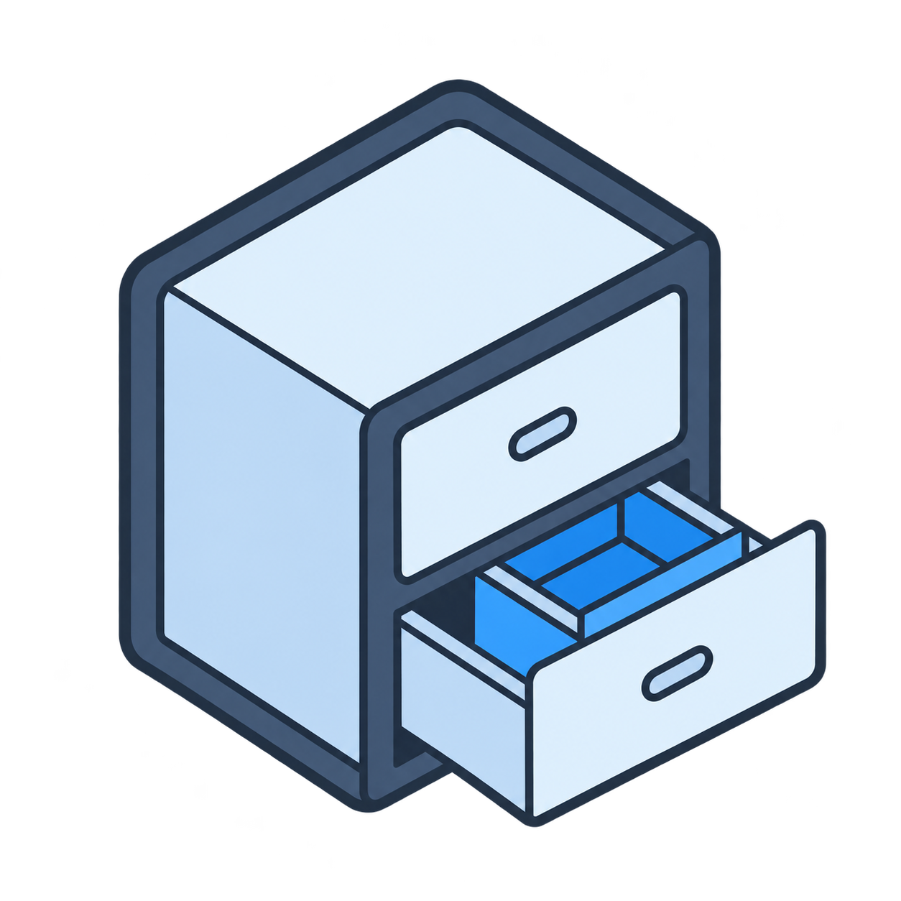

# 겹서랍 · Beta 0.0.2

**수행평가 다층 작업기억 관리 프로그램**

평가 자료와 점수, 관찰 기록을 여러 단계의 작업표로 정리하기 위해 만든 교사용 Windows 로컬 프로그램입니다. 직접 사용하며 개선하고 있는 **초기 시험 버전**입니다.



## 실행 파일 받기

[Releases](https://github.com/sukhavati44/gyeopseorap/releases)에서 **v0.0.2-beta**의 Windows ZIP을 내려받으세요. 압축을 완전히 푼 뒤 `겹서랍/START.exe`를 실행합니다. 실행파일만 옮기지 말고 소스·아이콘 파일도 함께 보관해 주세요. 단일 EXE 패키지는 아닙니다. 프로젝트 자료는 별도 폴더에 보관하며 업데이트 전에 백업해 주세요.

## 실행 환경

- Windows 64비트
- Windows PowerShell 5.1 및 .NET Framework 4.x
- 데스크톱 Microsoft Excel: 현재 Excel 파일 저장·반영에 필요합니다.

인터넷 연결이나 상용 AI 계정 없이 로컬에서 기본 작업을 합니다. 프로젝트 자료는 프로그램 밖의 별도 폴더에 저장합니다.

## 현재 할 수 있는 작업

- 학생별·평가영역별 종합표에서 점수 입력과 조회
- 열을 추가하고 필요한 깊이의 하위 작업표 생성·연결
- 하위 작업표의 합계와 상위 값이 다를 때 색으로 표시
- 선택한 하위 값을 교사가 직접 상위 표에 반영
- Excel 내보내기와 학생코드를 통한 자료 가져오기
- 여러 셀 선택, 클립보드 표 붙여넣기, 열별 정렬·검색
- 셀 메모 작성·자동 저장·전체 보기
- 열 머리글의 선택형 [배점] 메모: 가능한 점수 조합과 대조해 불가능한 점수를 빨간 굵은 글씨로 안내
- 학생 개별조회: 선택 항목 기준 하위 3층까지 조회
- 기록 내보내기: 작업표·항목·점수·내용과 값 옆의 메모·배점을 학생별 독립 XLSX로 출력 (1인 / 학급 단위, 이름 / 둘 다 / 코드)
- 프로젝트 단위 학생코드 발급, 재생성, 학생–코드 대조표 내보내기

## 간단한 사용 순서

1. 프로젝트를 만들거나 기존 프로젝트 폴더를 불러옵니다.
2. Excel/CSV 명부 또는 나이스 학급 파일을 반입합니다. 명부 없이 먼저 시작할 수도 있습니다.
3. 평가영역 아래 필요한 작업표와 숫자·문자 열을 만듭니다.
4. 직접 입력하거나, 학생코드가 붙은 `.xlsx` 자료를 [자료 가져오기]로 연결합니다. 하위 작업공간이 없는 최하위 표에서 가져오기를 권장합니다.
5. 파일의 학생 연결과 열별 저장 대상을 미리 확인한 후 현재 표에 저장합니다.
6. 상위 표에 보낼 값은 별도로 [상위에 반영]합니다. 하위 수정이 상위 점수를 자동으로 덮어쓰지는 않습니다.

숫자 열은 합계에 포함되고 문자 열은 합계에서 제외됩니다. 자료에 이미 있는 합계·최종 결과를 다시 합산하지 않도록 반입 화면에서 열 종류를 확인해 주세요. 셀 메모는 메모 입력 창에서 저장하면 바로 저장됩니다.

## Beta 0.0.2에서 알아둘 점

- 가상 자료를 중심으로 기능과 화면을 시험했습니다. 실제 학교 환경 전반, 다른 PC, 클라우드 동기화·동시 사용은 충분히 검증하지 않았습니다.
- 초기 시험판이므로 먼저 사본으로 시험하고 프로젝트 자료를 별도로 백업해 주세요.
- [자료 가져오기]는 표 형태의 `.xlsx`를 받습니다. PDF·이미지 자체의 OCR이나 AI 채점 기능은 포함하지 않습니다. 외부에서 정리한 결과를 학생코드로 연결하는 방식입니다.
- 자료 반입의 빈칸은 기본적으로 기존 값을 유지합니다. 빈칸으로 지우기는 별도 선택입니다.
- 상위·하위 값의 차이는 교사에게 표시하는 안내입니다. 자동으로 상위 점수를 바꾸거나 저장을 차단하지 않습니다. 배점 설정이 있는 열만 별도로 가능한 점수 조합과 대조합니다.
- 프로젝트/열 삭제와 휴지통 비우기는 구분되어 있습니다. 영구 삭제 전 확인 내용을 읽어 주세요.

## 0.0.2 사용 안내

- **좌측 [기록 내보내기]**는 현재 조회 항목·깊이에 관계없이 선택 학생의 전체 자료를 출력합니다. 학급 단위는 학생 1명당 파일 1개를 만듭니다.
- **하단 [학생 개별조회]**는 프로그램 안에서 현재 항목의 하위 3층까지 살펴보는 기능입니다.
- 작업 열 머리글을 우클릭해 **[배점 추가 / 수정 · 1행 메모]**를 선택합니다. 한 줄은 한 평가요소이며 같은 줄의 가능 점수를 쉼표·세미콜론으로 구분합니다. 배점이 없으면 대조하지 않습니다.
- 코드만 내보내도 원문·메모에 들어 있는 실명은 자동으로 지우지 않습니다. 생성 파일은 공유 전에 확인하세요.
- 긴 내용은 분할 번호와 함께 보존합니다. 출력의 원본 수식은 실행하지 않는 텍스트이며, 원본 첨부파일·백업 폴더의 바이너리 전체를 복제하는 기능은 아닙니다.

## 소스와 빌드

`src/`에 Windows Forms/PowerShell 소스와 C# 보조 코드를 보관합니다. 로컬에서 계속 수정하는 원본과 공개 배포 사본은 구분해 관리합니다.

Windows PowerShell 5.1에서 저장소 폴더를 열고 실행합니다.

```powershell
powershell.exe -NoProfile -ExecutionPolicy Bypass -File ./build.ps1
```

결과는 `dist/겹서랍/START.exe`입니다. `dist/겹서랍` 폴더 전체를 함께 사용하세요. 별도 패키지 다운로드나 학생 자료가 빌드에 필요하지 않습니다.

## 의견 남기기

[Issues](https://github.com/sukhavati44/gyeopseorap/issues)에 재현 순서와 기대한 동작을 남겨 주세요. 실제 학생 이름·코드·성적이 담긴 자료는 공개 이슈에 첨부하지 마세요.

변경 내용은 [CHANGELOG.md](CHANGELOG.md)에 정리합니다.

프로젝트 불러오기는 프로젝트 이름의 폴더를 선택합니다. 학생 기록 내보내기는 학급을 표시하고, 코드 옵션에서는 파일명과 학생정보에서 이름·번호를 제외합니다.
